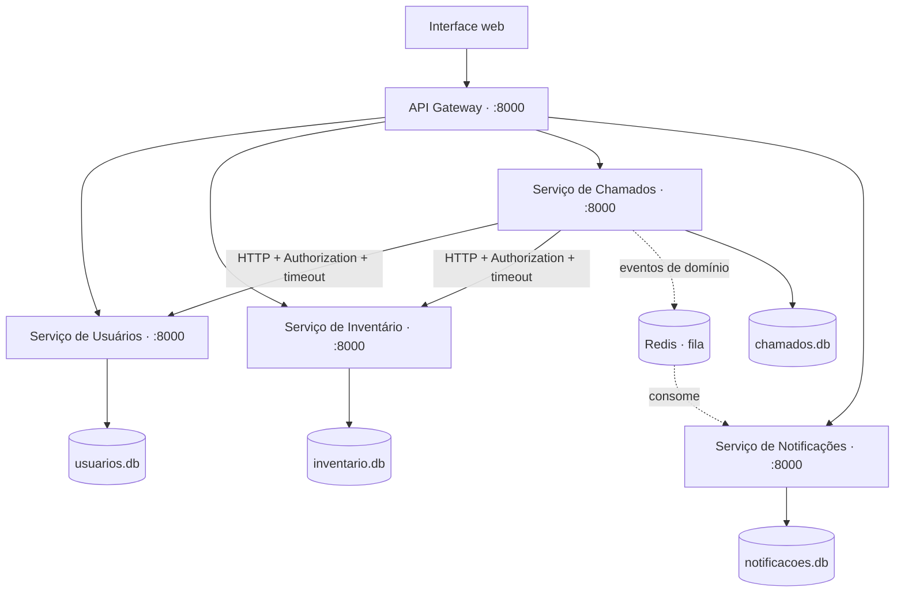

# HelpDesk TI — Arquitetura de Microsserviços

> **Vídeo de demonstração (4 a 6 minutos):** `COLOQUE_AQUI_O_LINK_DO_VIDEO`
>
> **Repositório:** `COLOQUE_AQUI_O_LINK_DO_SEU_REPOSITORIO`

Projeto acadêmico da disciplina de Arquitetura de Software. Esta versão transforma o HelpDesk TI original, que era um monólito, em serviços independentes, com bancos separados, comunicação HTTP e um API Gateway.

**Projeto de referência:** [prof-filipecavalcante/helpdesk-ti](https://github.com/prof-filipecavalcante/helpdesk-ti). O enunciado original foi mantido em [DESAFIO.md](DESAFIO.md).

## 1. Arquitetura proposta



A porta `8000` publicada na máquina é exclusivamente a do Gateway. As portas dos serviços e do Redis permanecem internas à rede Docker.

### Responsabilidade de cada serviço

| Serviço | Responsabilidade | Banco próprio |
|---|---|---|
| Usuários | Login, emissão de JWT, cadastro e consulta de usuários | `usuarios.db` |
| Inventário | Cadastro e consulta de equipamentos | `inventario.db` |
| Chamados | Abertura, atribuição, status, comentários, SLA e painel | `chamados.db` |
| Notificações | Consumo de eventos e consulta dos avisos do usuário | `notificacoes.db` |
| Gateway | Ponto único de entrada, encaminhamento HTTP e interface web | Não possui banco |

## 2. O que mudou em relação ao monólito

- Os módulos deixaram de compartilhar o mesmo processo e passaram a ser aplicações FastAPI independentes, cada uma com seu próprio `Dockerfile` e seu próprio objeto de metadata SQLAlchemy.
- Cada serviço recebe uma URL de banco exclusiva. O serviço de Chamados mantém apenas os IDs externos de solicitantes, técnicos e equipamentos; não há chaves estrangeiras entre bancos.
- Chamados consulta Usuários e Inventário pela rede HTTP, repassando o cabeçalho `Authorization` e usando timeout de 2 segundos.
- Erros de conexão ou timeout nos serviços consultados viram HTTP 503 com mensagem clara. A abertura sem equipamento não depende do Inventário.
- Cada serviço valida a assinatura, o emissor, o algoritmo e a validade do JWT antes de responder.
- Notificações são publicadas como eventos (`ChamadoAberto`, `ChamadoAtribuido` e `ChamadoResolvido`) em uma fila Redis. O consumidor grava os avisos no banco próprio. Se a fila/Notificações estiver indisponível, o chamado já salvo não é desfeito.
- O Gateway preserva os caminhos usados pela interface original: `/auth`, `/usuarios`, `/ativos`, `/chamados` e `/notificacoes`.

### Decisões e trade-offs

**Vantagens:** implantação e escala independentes, isolamento dos dados, menor acoplamento entre domínios e falhas localizadas.

**Custos:** comunicação de rede pode falhar; é preciso tratar timeout/503; autenticação precisa ser verificada em todos os serviços; e a operação exige mais contêineres, configuração e monitoramento. IDs externos não têm a integridade referencial automática de uma FK entre tabelas.

## 3. Tecnologias

- Python 3.12 e FastAPI
- SQLAlchemy e SQLite (um arquivo/volume por serviço)
- JWT HS256 com segredo por variável de ambiente
- HTTPX para chamadas HTTP entre serviços
- Redis para a fila de eventos
- Docker Compose para orquestração
- Pytest e GitHub Actions para testes automatizados

## 4. Como executar

Pré-requisitos: Docker Desktop instalado e aberto, com Docker Compose disponível.

1. Na pasta do projeto, crie o arquivo `.env` a partir do exemplo:

   **PowerShell:**
   ```powershell
   Copy-Item .env.example .env
   ```

2. Gere um segredo JWT exclusivo:
   ```powershell
   python -c "import secrets; print(secrets.token_urlsafe(48))"
   ```
   Copie o resultado e substitua o valor de `JWT_SEGREDO` dentro do `.env`. Não envie esse arquivo ao GitHub.

3. Suba a aplicação:
   ```powershell
   docker compose up --build
   ```

4. Em outro terminal, confira os contêineres:
   ```powershell
   docker compose ps
   ```

5. Acesse a interface e a documentação:
   - Interface: http://localhost:8000
   - Saúde dos serviços: http://localhost:8000/saude
   - Swagger do Gateway: http://localhost:8000/docs

Para encerrar, use `Ctrl+C` e depois `docker compose down`. Os dados continuam nos volumes. Para apagar os dados de teste também, use `docker compose down -v`.

### Contas de demonstração

Com `DADOS_EXEMPLO=1`, as contas de aula são criadas no primeiro início de cada banco vazio. A senha padrão é `Helpdesk2026` (pode ser trocada por `SENHA_EXEMPLO` no `.env`).

| E-mail | Perfil |
|---|---|
| `admin@empresa.com` | Administrador |
| `carla@empresa.com` | Técnica |
| `diego@empresa.com` | Técnico |
| `ana@empresa.com` | Solicitante |
| `bruno@empresa.com` | Solicitante |

Use Carla para demonstrar o fluxo completo. Use Ana para demonstrar que ela não consegue consultar os chamados de Bruno.

## 5. Como demonstrar a falha isolada do Inventário

Com os contêineres em execução:

```powershell
docker compose stop inventario
```

A interface continua consultando Usuários e Chamados. A lista de equipamentos pode ficar indisponível e, ao tentar abrir um chamado selecionando um equipamento, o serviço de Chamados responde `503` com uma mensagem informando que o Inventário está indisponível. O sistema não fica esperando indefinidamente porque a chamada possui timeout.

Restaure o serviço:

```powershell
docker compose start inventario
```

## 6. Segurança

- As rotas de negócio exigem `Authorization: Bearer <token>`; cada microsserviço valida o JWT localmente.
- O segredo `JWT_SEGREDO` vem do `.env` e não está no código nem deve ser commitado.
- Solicitantes veem apenas os próprios chamados; técnicos e administradores veem todos. Só equipe atribui e resolve; o solicitante pode fechar ou reabrir o próprio chamado resolvido.
- A API pública de usuários não devolve e-mails na listagem.
- Apenas o Gateway publica a porta `8000` no host; serviços e bancos ficam na rede interna do Compose.
- Contêineres de aplicação executam sem root, com filesystem somente leitura, sem capacidades extras e com `no-new-privileges`.
- As senhas continuam armazenadas com hash scrypt e sal aleatório.

## 7. Testes

Com Python instalado, execute:

```powershell
python -m venv .venv
.venv\Scripts\Activate.ps1
pip install -r requirements-dev.txt
pytest -q
```

Os testes cobrem exigência e rejeição de tokens, login, permissões de perfil, privacidade dos chamados de outros solicitantes e rotas de saúde. O GitHub Actions executa a suíte em cada push e pull request.

## 8. Rotas principais

| Método | Rota | Serviço | Acesso |
|---|---|---|---|
| POST | `/auth/login` | Usuários | Público |
| GET | `/auth/eu` | Usuários | Logado |
| GET / POST | `/usuarios` | Usuários | Logado / admin |
| GET / POST | `/ativos` | Inventário | Logado / técnico ou admin |
| GET / POST | `/chamados` | Chamados | Logado |
| GET | `/chamados/painel` | Chamados | Logado |
| PATCH | `/chamados/{id}/atribuir` | Chamados | Técnico ou admin |
| PATCH | `/chamados/{id}/status` | Chamados | Conforme regra de status/perfil |
| POST | `/chamados/{id}/comentarios` | Chamados | Envolvidos |
| GET | `/notificacoes` | Notificações | Logado (apenas as próprias) |
| GET | `/saude` | Gateway | Público; resume a saúde dos serviços |

## 9. Roteiro do vídeo (4–6 minutos)

1. **Arquitetura (40–50 s):** mostre este diagrama; explique a função dos quatro serviços, do Gateway, dos bancos separados e da fila Redis.
2. **Subida (30–40 s):** execute `docker compose up --build`; em outro terminal, `docker compose ps` e abra `/saude`.
3. **Fluxo (60–80 s):** entre como Carla; crie chamado com equipamento, atribua a um técnico, resolva e feche. Mostre o painel e as notificações.
4. **Segurança (35–45 s):** mostre uma rota protegida sem token retornando 401 (por exemplo `/chamados`) e entre como Ana para mostrar que o chamado de Bruno não aparece / retorna 404.
5. **Bancos separados (20–30 s):** mostre os volumes `usuarios_data`, `inventario_data`, `chamados_data` e `notificacoes_data` no `docker compose.yml` ou com `docker volume ls`.
6. **Falha (45–60 s):** `docker compose stop inventario`; atualize a tela; mostre Usuários e Chamados ainda carregando e a abertura com equipamento retornando 503; depois use `docker compose start inventario`.
7. **Conclusão (20–30 s):** explique que agora cada parte pode ser implantada separadamente, mas a arquitetura também exige rede, timeout, observabilidade e tratamento de falhas.

Fale com suas palavras e mantenha o vídeo entre 4 e 6 minutos. Publique como não listado no YouTube ou com acesso por link no Google Drive e substitua o campo do vídeo no início deste README.
